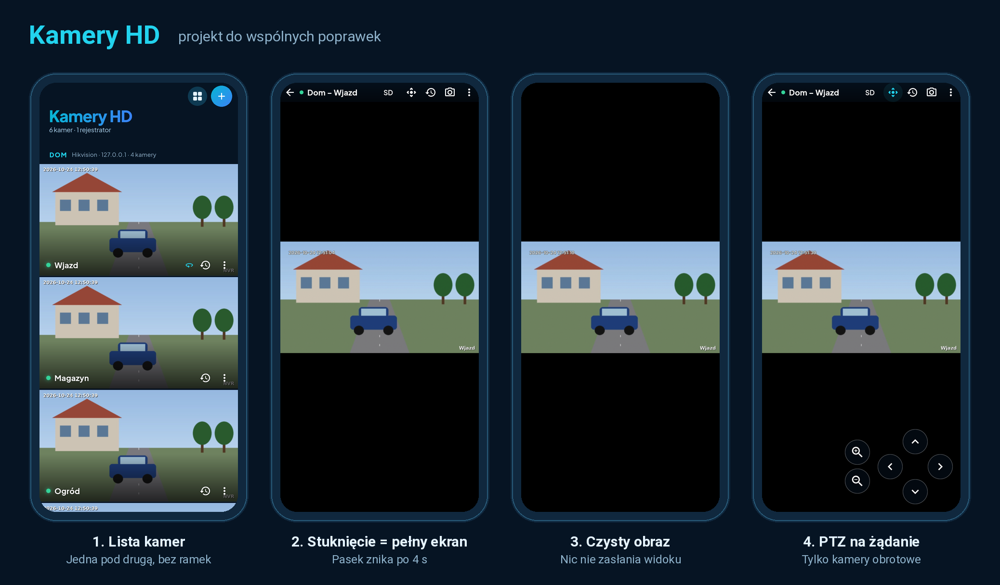

# Kamery HD

Aplikacja na **Androida i iPhone'a** do podglądu kamer **Hikvision** i **Dahua**
(kamery IP oraz kanały rejestratorów NVR/DVR).

## Funkcje
- lista kamer obu marek, test połączenia (pokazuje model i firmware, sprawdza hasło),
- podgląd na żywo RTSP (SD/HD, obsługa H.264 i H.265),
- tryb zdjęć – odświeżane klatki przez HTTP, gdy RTSP nie działa,
- siatka – wszystkie kamery naraz,
- **nagrania z rejestratora** NVR/DVR lub karty SD: wybór dnia, oś czasu z fragmentami nagrań, odtwarzanie od dowolnej chwili,
- sterowanie PTZ (obrót, pochylenie, zoom),
- zapis zrzutu do Galerii / Zdjęć.

## Skąd pobrać aplikację
Po każdej zmianie w kodzie GitHub sam buduje aplikację (zakładka **Actions**, ok. 15 minut).
Gotowe pliki są w zakładce **Releases** (po prawej stronie repozytorium) → najnowsza wersja:

- `KameryHD.apk` – Android
- `KameryHD.ipa` – iPhone

### Android
1. Na telefonie otwórz repozytorium (zaloguj się na GitHub), wejdź w **Releases** i pobierz `KameryHD.apk`.
2. Otwórz pobrany plik i zezwól na instalację z tego źródła.

### iPhone (darmowe Apple ID, bez Maca)
1. Na komputerze (Windows lub Mac) zainstaluj **iTunes** (Windows: wersja ze strony Apple, nie ze Sklepu Microsoft) i **Sideloadly** – https://sideloadly.io
2. Pobierz `KameryHD.ipa` z **Releases**.
3. Podłącz iPhone'a kablem, w Sideloadly przeciągnij plik `.ipa`, wpisz swoje Apple ID i kliknij **Start**.
4. Na iPhonie: **Ustawienia → Ogólne → VPN i urządzenia** → zaufaj swojemu Apple ID.
5. iOS 16 i nowszy: **Ustawienia → Prywatność i ochrona → Tryb dewelopera** → włącz (telefon się zrestartuje).
6. Przy pierwszym uruchomieniu zezwól aplikacji na dostęp do **sieci lokalnej**.

Przy darmowym Apple ID aplikacja działa 7 dni – potem wystarczy ponownie kliknąć Start w Sideloadly
(dane kamer zostają). Płatne konto Apple Developer (99 USD/rok) usuwa to ograniczenie i pozwala
na TestFlight / App Store.

## Konfiguracja kamery
- Włączony RTSP (port 554) i HTTP (port 80).
- Kanał: `1` dla kamery, `1…N` dla rejestratora.
- Strumień **SD** jest szybszy i oszczędza transfer, **HD** to pełna rozdzielczość.
- Dostęp spoza domu: przekierowanie portów 554 i 80 na routerze + DDNS albo VPN.
  Chmura P2P (Hik-Connect, DMSS) nie jest obsługiwana – wymaga zamkniętych SDK producentów.

## Adresy używane przez aplikację
| | Hikvision | Dahua |
|---|---|---|
| RTSP | `/Streaming/Channels/101` (102 = SD, 201 = kanał 2) | `/cam/realmonitor?channel=1&subtype=0` (1 = SD) |
| Zdjęcie | `/ISAPI/Streaming/channels/101/picture` | `/cgi-bin/snapshot.cgi?channel=1` |
| Info | `/ISAPI/System/deviceInfo` | `/cgi-bin/magicBox.cgi?action=getSystemInfo` |
| PTZ | `PUT /ISAPI/PTZCtrl/channels/1/continuous` | `/cgi-bin/ptz.cgi?action=start&code=Up…` |
| Wyszukiwanie nagrań | `POST /ISAPI/ContentMgmt/search` | `/cgi-bin/mediaFileFind.cgi` |
| Odtwarzanie nagrań | `rtsp://…/Streaming/tracks/101?starttime=…` | `rtsp://…/cam/playback?channel=1&starttime=…` |

## Dla programisty
Flutter 3.47, kod w `lib/`, testy w `test/` (`flutter test`), budowanie w `.github/workflows/build.yml`.

Stały klucz podpisu Androida podaje się w **Settings → Secrets and variables → Actions**:
`ANDROID_KEYSTORE_BASE64` (plik `.jks` zakodowany base64, alias `kamery`) i `ANDROID_KEYSTORE_PASSWORD`.
Bez nich APK jest podpisany kluczem testowym, a każdą nową wersję trzeba instalować po odinstalowaniu starej.
